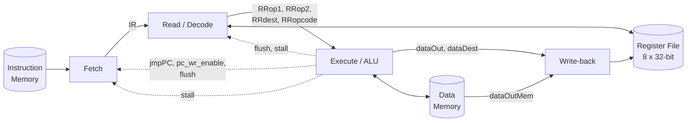

# DSD_PipeLine

A 4-stage pipelined 16-bit RISC-style CPU written in Verilog. The design has a custom instruction set, an 8-register file, separate instruction and data memories, and hardware support for load stalls and jump flushes.

## Overview

DSD_PipeLine is a digital system design project that implements a small processor from scratch. Instructions are 16 bits wide, data is 32 bits wide, and the address space is parameterized (`A_SIZE = 20`). The pipeline overlaps instruction fetch, decode/register read, execution, and write-back, and it resolves control hazards (jumps) and memory-latency hazards (loads) in hardware.

## Key Features

- 4-stage pipeline: **Fetch → Read → Execute → Write-back**
- 16-bit instruction word, 32-bit datapath, 8 general-purpose registers (`R0`-`R7`)
- Arithmetic, logic, and shift instructions
- Load/store architecture with a synchronous data memory (2-cycle read latency)
- Absolute and relative jumps, plus conditional jumps (`<= 0`, `>= 0`, `== 0`, `!= 0`)
- Hardware **stall** on `LOAD` to cover the data memory latency
- Hardware **flush** of the Fetch and Read stages when a jump is taken
- Fully parameterized through a single macro header (`cpu_macros.vh`)

## Architecture



| Stage | Module | Description |
|-------|--------|-------------|
| Fetch | `fetch_stage` | Holds the program counter, reads the instruction memory, and loads the instruction register (`IR`). Handles jump redirect, stall (holds `PC`/`IR`), and flush. |
| Read | `read_stage` | Combinational instruction decoder that selects the source registers, then latches operands, destination, and opcode into the Read→Execute pipeline registers (`RRop1`, `RRop2`, `RRdest`, `RRopcode`). |
| Execute | `execute_stage` | Combinational ALU and branch unit, plus a small FSM that drives the data memory for `LOAD`/`STORE`. Generates `stall`, `flush`, `jmpPC`, and `pc_wr_enable`. |
| Write-back | `write_back_stage` | Selects between the ALU result and the data memory output and drives the register file write port. |

Supporting modules:

| Module | Description |
|--------|-------------|
| `cpu_pipe` | Top-level module (`clk`, `rst`) that wires all stages, memories, and the register file together. |
| `cpu_registers` | 8 x 32-bit register file with two asynchronous read ports and one synchronous write port. |
| `instr_memory` | Instruction ROM initialized with a demo program. |
| `data_memory` | Synchronous data RAM; read data is available 2 clock cycles after the read request. |
| `cpu_macros.vh` | Global parameters, register names, and opcode definitions. |

### Hazard handling

- **Control hazards:** jumps are resolved in the Execute stage. When a jump is taken, `pc_wr_enable` redirects the `PC` to `jmpPC`, and `flush` clears the instructions already in the Fetch and Read stages.
- **Load-use latency:** on a `LOAD`, Execute asserts `stall` to freeze Fetch and Read while the data memory completes its 2-cycle read, then Write-back picks up the memory data.
- **Data hazards:** there is no forwarding unit, so dependent instructions must be separated by `NOP`s (the demo program does this).

## Instruction Set

All instructions are 16 bits. The opcode is variable-length (7, 5, or 4 bits) and sits in the upper bits.

### ALU instructions (7-bit opcode)

Format: `[15:9] opcode | [8:6] dest | [5:3] src1 | [2:0] src2`

| Mnemonic | Opcode | Operation |
|----------|--------|-----------|
| `NOP` | `0000000` | No operation |
| `ADD` / `ADDF` | `0000001` / `0000010` | `dest = src1 + src2` |
| `SUB` / `SUBF` | `0000011` / `0000100` | `dest = src1 - src2` |
| `AND` | `0000101` | `dest = src1 & src2` |
| `OR` | `0000110` | `dest = src1 \| src2` |
| `XOR` | `0000111` | `dest = src1 ^ src2` |
| `NAND` | `0001000` | `dest = ~(src1 & src2)` |
| `NOR` | `0001001` | `dest = ~(src1 \| src2)` |
| `NXOR` | `0001010` | `dest = ~(src1 ^ src2)` |
| `SHIFTR` / `SHIFTRA` / `SHIFTL` | `0001011` / `0001100` / `0001101` | Shift by a 6-bit immediate in `[5:0]`; `dest` in `[8:6]` |

### Memory instructions (5-bit opcode)

| Mnemonic | Encoding | Operation |
|----------|----------|-----------|
| `LOADC` | `11000 \| dest[10:8] \| imm[7:0]` | `dest = imm` (load constant) |
| `LOAD` | `10000 \| dest[10:8] \| ... \| addrReg[2:0]` | `dest = MEM[addrReg]` |
| `STORE` | `10100 \| addrReg[10:8] \| ... \| valueReg[2:0]` | `MEM[addrReg] = valueReg` |

### Control-flow instructions (4-bit opcode)

| Mnemonic | Encoding | Operation |
|----------|----------|-----------|
| `JMP` | `1111 \| ... \| reg[2:0]` | `PC = reg` (absolute) |
| `JMPR` | `1110 \| ... \| imm[5:0]` | `PC = imm` |
| `JMPcond` | `1101 \| cond[11:9] \| reg[8:6] \| ... \| target[2:0]` | Jump to the address in `target` if `reg` satisfies `cond` |
| `JMPRcond` | `1001 \| cond[11:9] \| reg[8:6] \| imm[5:0]` | Jump to `imm` if `reg` satisfies `cond` |

Conditions (`cond`): `000` → `<= 0`, `001` → `>= 0`, `010` → `== 0`, `011` → `!= 0`.

## Repository Structure

```
DSD_PipeLine/
├── cpu_macros.vh       # Parameters, register names, opcodes
├── cpu_pipe.v          # Top-level module
├── fetch_stage.v       # Stage 1: instruction fetch + PC
├── read_stage.v        # Stage 2: decode + register read
├── execute_stage.v     # Stage 3: ALU, branch unit, memory FSM
├── write_back_stage.v  # Stage 4: write-back mux
├── cpu_registers.v     # 8 x 32-bit register file
├── instr_memory.v      # Instruction memory (demo program)
├── data_memory.v       # Synchronous data memory
└── README.md
```

## Demo Program

`instr_memory.v` ships with a short program that exercises most of the pipeline:

```
LOADC R2, 7        ; R2 = 7
LOADC R3, 3        ; R3 = 3
LOADC R4, 0        ; R4 = 0
NOP
NOP
ADD   R2, R2, R3   ; R2 = 10
...                ; NOPs to resolve data hazards
STORE R4, R2       ; MEM[R4] = R2
...
LOAD  R4, R5       ; R4 = MEM[R5]  (triggers a 2-cycle stall)
...
JMP   R4           ; jump to the loaded address (flushes the pipeline)
```

## Getting Started

```bash
git clone https://github.com/Myronul/DSD_PipeLine.git
cd DSD_PipeLine
```

1. Create a new project in your Verilog simulator or FPGA toolchain (e.g., Vivado, ModelSim, Icarus Verilog).
2. Add all `.v` files and make sure `cpu_macros.vh` is on the include path.
3. Set `cpu_pipe` as the top module and drive its two inputs: `clk` and `rst` (active-high, asynchronous).
4. Write your own testbench, or simply toggle `clk` and observe the signals below.

Useful signals to inspect: `PC`, `IR`, `RRopcode`, `dataOut`, `stall`, `flush`, `wb_regAddr`, `wb_regValue`, and the register file contents.

## Configuration

Edit `cpu_macros.vh` to change the core parameters:

| Macro | Default | Meaning |
|-------|---------|---------|
| `A_SIZE` | 20 | Address width |
| `D_SIZE` | 32 | Data width |
| `INSTR_SIZE` | 16 | Instruction width |
| `REG_ADR` | 3 | Register address width (8 registers) |
| `OPCODE_SIZE` | 7 | Width of the pipelined opcode field |

## Possible Improvements

- Data forwarding and hazard detection to remove the need for software `NOP`s
- Signed comparison for the conditional jumps
- Larger instruction memory and a program loader
- A self-checking testbench and FPGA constraints for board bring-up

## Author

**Andrei Miron** ([@Myronul](https://github.com/Myronul))
